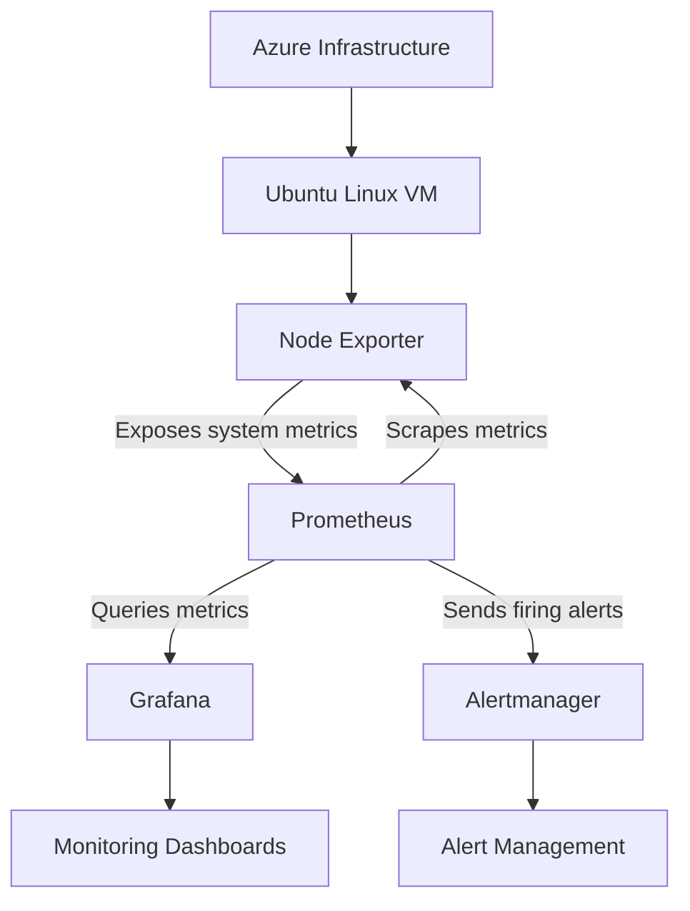

# Linux Monitoring & Observability Platform

A self-hosted Linux server monitoring platform deployed on Microsoft Azure using Terraform, Docker Compose, Prometheus, Grafana, Node Exporter, and Alertmanager.

The platform collects system-level metrics from an Ubuntu Linux VM, visualizes resource utilization through Grafana dashboards, and evaluates alert rules using Prometheus with Alertmanager for alert management.

## Architecture



## Technology Stack

| Technology      | Purpose                              |
| --------------- | ------------------------------------ |
| Microsoft Azure | Cloud infrastructure                 |
| Terraform       | Infrastructure provisioning          |
| Ubuntu Linux    | Monitoring host                      |
| Docker          | Containerization                     |
| Docker Compose  | Container orchestration              |
| Prometheus      | Metrics collection and storage       |
| Node Exporter   | Linux system metrics exporter        |
| Grafana         | Metrics visualization and dashboards |
| Alertmanager    | Alert grouping and management        |

## Features

- **Infrastructure Provisioning:** Azure VM and networking resources provisioned using Terraform.
- **Containerized Deployment:** Monitoring services deployed using Docker Compose.
- **System Monitoring:** Collects CPU, memory, disk, filesystem, and network metrics.
- **Metrics Collection:** Prometheus periodically scrapes Node Exporter.
- **Visualization:** Grafana dashboards provide visibility into Linux server performance.
- **Alert Rules:** Prometheus evaluates configurable rules for CPU, memory, disk space, and Node Exporter availability.
- **Alert Management:** Alertmanager receives and manages alerts generated by Prometheus.
- **Persistent Storage:** Docker volumes preserve Prometheus and Grafana data across container restarts.

## Alert Rules

The platform includes the following monitoring rules:

| Alert            | Condition                              | Severity |
| ---------------- | -------------------------------------- | -------- |
| HighCPUUsage     | CPU usage above 80% for 2 minutes      | Warning  |
| HighMemoryUsage  | Memory usage above 85% for 2 minutes   | Warning  |
| LowDiskSpace     | Available disk space below 15%         | Critical |
| NodeExporterDown | Node Exporter unavailable for 1 minute | Critical |

## Deployment

### 1. Provision Azure Infrastructure

Navigate to the Terraform directory:

```bash
cd terraform
terraform init
terraform plan
terraform apply
```

### 2. Connect to the Linux VM

Connect using SSH:

```bash
ssh azureuser@<VM_PUBLIC_IP>
```

### 3. Configure Environment Variables

Create a `.env` file in the project root:

```env
GRAFANA_ADMIN_PASSWORD=your_secure_password
```

### 4. Deploy Monitoring Services

Start the monitoring stack:

```bash
docker-compose up -d
```

Check container status:

```bash
docker-compose ps
```

### 5. Access the Monitoring Interfaces

The monitoring interfaces are bound to localhost on the VM to avoid exposing them publicly.

Use SSH port forwarding from your local machine:

```bash
ssh -L 3000:127.0.0.1:3000 \
    -L 9090:127.0.0.1:9090 \
    -L 9093:127.0.0.1:9093 \
    azureuser@<VM_PUBLIC_IP>
```

Open the following URLs in your browser:

| Service      | URL                                            |
| ------------ | ---------------------------------------------- |
| Grafana      | [http://localhost:3000](http://localhost:3000) |
| Prometheus   | [http://localhost:9090](http://localhost:9090) |
| Alertmanager | [http://localhost:9093](http://localhost:9093) |

Grafana default username: `admin`

The password is the value configured in `.env`.

## Security Considerations

- Monitoring interfaces are bound to `127.0.0.1` and accessed through SSH tunneling.
- Node Exporter is accessible internally through the Docker Compose network.
- Credentials are stored in environment variables rather than committed to source control.
